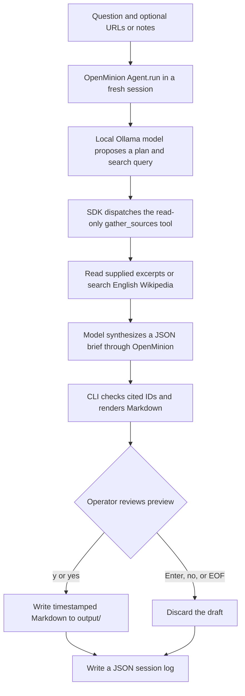

# Research Brief Agent

A command-line research assistant for Cortensor Hackathon #5. Give it a question
and, optionally, public HTTPS URLs or local text notes. It builds a short,
source-cited Markdown brief for a developer, researcher, or teammate who needs
to understand a topic and decide what to verify next.

## How it works



OpenMinion owns the model turn, scoped tool registration and dispatch, and
session state. The app uses `openminion.Agent` and `openminion.tool`, passes
`forced_tools=["gather_sources"]`, and runs the agent through the configured
Ollama adapter. The single tool receives the plan and
search query. When the operator supplies sources, those sources are the
evidence set. Otherwise, the tool uses the query to request up to two Wikipedia
introductory extracts. Each retrieved source receives a stable ID for that brief.

The CLI validates the final JSON with a Pydantic schema, checks references to
retrieved IDs, and prints the entire Markdown before asking whether to save it.
File writing is an ordinary CLI operation gated by
the operator. The session log records tool completion, source IDs or failures,
SDK run/thread IDs when available, elapsed time, and the save decision.
OpenMinion keeps its own session state under the configured home.

## Prerequisites and setup

Use Python 3.11 or newer and [Ollama](https://ollama.com/download) with space for
a roughly 2 GB model. The tested setup ran CPU-only with an 8,192-token context.
The official [OpenMinion 0.1.24 package](https://pypi.org/project/openminion/0.1.24/)
is installed by the project dependencies.

```bash
git clone https://github.com/ZQ051031/cortensor-hackathon-5.git
cd cortensor-hackathon-5
python3.11 -m venv .venv
source .venv/bin/activate
python -m pip install -r requirements.txt
```

Start Ollama in another terminal. If an Ollama app or service is already
listening on port 11434, configure its context length and use that instance.

```bash
OLLAMA_HOST=127.0.0.1:11434 OLLAMA_NO_CLOUD=1 OLLAMA_CONTEXT_LENGTH=8192 ollama serve
```

In the repo terminal, pull the model and set an isolated SDK home.

```bash
ollama pull qwen2.5:3b-instruct
export OPENMINION_HOME="$PWD/.openminion-home"
openminion setup --provider ollama --model qwen2.5:3b-instruct --no-chat
```

The setup command writes a default provider configuration for ordinary SDK
discovery. The research demo below uses the checked-in
[Ollama profile](config/ollama.json), which selects native tool calls,
allows more time per model request on CPU, and skips automatic extraction of
user facts for memory. Keep the same `OPENMINION_HOME`
in any terminal that runs or inspects the demo. To select a different SDK
configuration, pass `--config /path/to/agents.json` or set
`RESEARCH_BRIEF_CONFIG`. To select a model on that profile, pass `--model`
or set `RESEARCH_BRIEF_MODEL`. The [.env.example](.env.example) lists the app
variables. Command-line values take priority.

## Run the model-backed example

```bash
research-brief 'What does READ_ONLY declare in the OpenMinion Python SDK lookup_order example? Paraphrase the evidence.' \
  --url https://raw.githubusercontent.com/openminion/openminion/v0.1.24/examples/sdk/tool_agent.py \
  --note examples/scope-notes.md \
  --config config/ollama.json \
  --model qwen2.5:3b-instruct
```

Type `y` after reading the preview to save the brief. Press Enter to discard
it. Inspect `output/sessions/` for the run log. See the
[sample brief](examples/sample-brief.md) and the
[commands, timings, and output paths](TEST_RESULTS.md#live-model-verification).

In the tagged example, `min_scope="READ_ONLY"` declares the minimum SDK
policy scope required to call the tool. The Python function determines how
it accesses data.

Other inputs

```bash
research-brief 'What happened during the Apollo 11 landing?' --config config/ollama.json
research-brief 'What decisions and open issues are in these notes?' \
  --note ./meeting.md --config config/ollama.json
```

Use up to four total `--url` and `--note` inputs. If you want research to stay
within local files, pass only `--note` inputs and use the local model. The
source-free command sends the model's search query to English Wikipedia.

## Testing and diagnostics

```bash
python -m pytest -q
python -m pip check
openminion --config config/ollama.json sessions list
```

The offline pytest suite passed all 28 tests using local fixtures.
`pip check`, Ruff, and the wheel build also passed.
See [TEST_RESULTS.md](TEST_RESULTS.md) for the commands and live run.
See [Building Blocks Tested](docs/BUILDING_BLOCKS_TESTED.md) for the SDK
interfaces and reproduction steps, and [What We Learned](docs/WHAT_WE_LEARNED.md)
for product feedback.

| Symptom | What to check |
| --- | --- |
| Model request failed | Check `ollama list`, `curl -f http://127.0.0.1:11434/api/version`, and `OPENMINION_HOME`. A full Ollama installation needs its model runner and shared libraries. |
| Invalid brief or missing evidence | Check the session log for source failures and try shorter or more salient inputs. Allow enough context for the excerpts and generated JSON. A model can return malformed output or cite an ID the tool did not return. |
| URL failed | Supply the final public HTTPS URL for a text or HTML page. Prefer a versioned raw Markdown file for developer docs when available. |
| Preview visible and no Markdown file | Accept the prompt with an explicit `y` or `yes`. An empty answer or EOF leaves only the session log. |

## Limitations

- Fetches public HTTPS text or static HTML and reads UTF-8 notes. It uses up to
  1,200 characters per source, marks capped excerpts, and requires the final URL
  for pages that redirect. Wikipedia discovery works best for general topics.
  Supply your own sources for niche questions.
- Citation validation confirms that the IDs refer to retrieved sources. Review
  each claim against the original material, particularly for truncated sources
  and changing documentation.
- CPU inference may take several minutes. The SDK can make additional model
  calls to check completion. Small models can time out or return invalid JSON,
  especially on broad questions.
- Treat source excerpts and model text as untrusted. The tool can read only
  paths or public URLs passed by the operator, or query the fixed Wikipedia
  endpoint. OpenMinion can persist prompts and tool messages locally. Use public
  demo inputs and keep the SDK state and output directories private.

## Project structure

```text
src/research_brief/      CLI, SDK agent, source collection, and Markdown renderer
config/ollama.json       Local provider settings used by the demo
tests/                  Offline pytest suite
examples/               Demo scope note and real generated brief
docs/                   Building-block findings, product feedback, and demo script
TEST_RESULTS.md         Verification commands and observed results
```

## DoraHacks submission

The repository contains the working example, setup instructions, verification
evidence, and both findings notes. Follow the [demo script](docs/DEMO.md) to
record a 1–5 minute video. Submit the public repo and video links in your PR
to the dedicated Hackathon #5 submission repository. Confirm the submission
repository through the organizers' official channels. The DoraHacks listing
gives the cutoff as December 19, 2026 at 07:59 UTC (December 18 Pacific Time).

Official references

- [Cortensor Hackathon #5 on DoraHacks](https://dorahacks.io/hackathon/2418/detail)
- [Cortensor GitBook entry](https://docs.cortensor.network/community-and-ecosystem/hackathon/hackathon-5)
- [OpenMinion v0.1.24 source](https://github.com/openminion/openminion/tree/v0.1.24) and [Python SDK examples](https://github.com/openminion/openminion/tree/v0.1.24/examples/sdk)
- [OpenMinion tool-using agent](https://www.openminion.com/docs/examples/python/tool-using-agent/), [sessions](https://www.openminion.com/docs/examples/python/sessions-and-multi-user/), [structured output](https://www.openminion.com/docs/examples/python/structured-output/), and [Ollama](https://www.openminion.com/docs/examples/providers/ollama/) documentation
